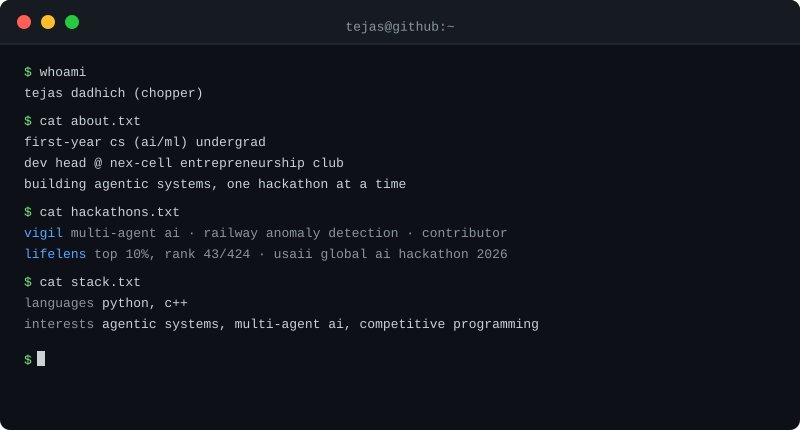

<div align="center">

[](https://github.com/Tejaa11)

[`github`](https://github.com/Tejaa11) [`linkedin`](https://www.linkedin.com/in/tejas-dadhich653/) [`email`](mailto:dadhichtejas653@gmail.com)

</div>

---

### Hackathons

| | |
|---|---|
| **[VIGIL](https://github.com/hub-mayank/vigil-platform)** | Multi-agent AI platform for railway signal anomaly detection. Built by a 4-person team at FAR AWAY 2026. Contributed presentation, visuals, and frontend. Framed by the team as a company seed, not just a hackathon entry. [`repo`](https://github.com/hub-mayank/vigil-platform) [`demo`](https://drive.google.com/file/d/1D4ErFd7KxERyWcuPdhcXOYzSkDtXT3NT/view?usp=sharing) [`live`](https://vigil-platform-six.vercel.app/?v=2) |
| **[LifeLens](https://github.com/adityapathak-dev/LIfeLens)** | Top 10% finalist, rank 43/424, USAII Global AI Hackathon 2026. Contributor on a team project. [`repo`](https://github.com/adityapathak-dev/LIfeLens) [`demo`](https://youtu.be/43tAQO-5JvQ) [`live`](https://l-ife-lens.vercel.app/) |

---

### Building

#### Pranati
Citizen-science platform turning smartphone photos of urban plant leaves into hyperlocal air quality estimates. An AI model reads leaf damage and stomatal stress as a proxy signal; geospatial interpolation then fills AQI estimates across a neighborhood without physical sensors. In progress, led by a four-person team (Navadhara) — Aditya as co-lead, Parth and Mayank in support. Submitted to the Asian Hackathon for Green Future, USAII Global AI Hackathon, Samsung Solve for Tomorrow, and HackHazards '26.

Stack: React.js, Tailwind CSS, Google Gemini Vision API, Firebase Firestore, Leaflet.js, Vercel. Core differentiator: an XGBoost + SHAP fusion layer combining leaf-damage classification with stomatal aperture data — also the basis of a patent claim.

#### Stockroom
In progress — repository and project details coming soon.

#### Student Admin Dashboard
In progress — repository and project details coming soon.


---

### Contribution graph

<p align="center">
  <picture>
    <source media="(prefers-color-scheme: dark)" srcset="https://raw.githubusercontent.com/Tejaa11/Tejaa11/output/github-contribution-grid-snake-dark.svg">
    <source media="(prefers-color-scheme: light)" srcset="https://raw.githubusercontent.com/Tejaa11/Tejaa11/output/github-contribution-grid-snake.svg">
    
  </picture>
</p>

<p align="center">
  <a href="https://github.com/Tejaa11?tab=overview">
    
  </a>
</p>

---


**`$ cat about.txt`**

First-year CS (AI/ML) undergrad. Dev Head at NEX-CELL Entrepreneurship Club. Building agentic systems and multi-agent AI platforms through hackathons — VIGIL and LifeLens both placed. Also does competitive programming.

**`$ cat stack.txt`**

```
languages   python, c++
interests   agentic systems, multi-agent ai, competitive programming
```

---

<div align="center">

*Always down to talk AI/ML, agentic systems, or hackathons.*

</div>
